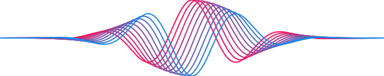

<div align="center">

<br/><br/>

</div>

Python constructors and rendering for [Gum](https://github.com/CompendiumLabs/gum-jsx).
Build plots, diagrams, documents, and math in Python, then render SVG, PNG, RGBA
pixels, PDF, PowerPoint, or kitty terminal graphics. Elements also display in
Jupyter notebooks.

This adapter targets the Gum **2.1.0-beta.0** libraries. The backend runs their
TypeScript sources with **Bun 1.4.2 or newer**. Node alone cannot run this source
adapter. `GUM_JSX_RUNTIME` can point to a different Bun executable.

## Installation

From this checkout:

```sh
pip install -e '.[plotting]'
python -m gum --install
```

The `plotting` extra installs NumPy and pandas for the high-level plotting
helpers. The base package requires only Pillow. The second command installs
JavaScript dependencies in `gum/js`; it is also needed after installing a Python
wheel. Importing `gum` and constructing JSX do not start Bun. The renderer starts
on the first render request and is reused until Python exits.

To work against your current local Gum workspace, install that workspace's
dependencies, then link this adapter to its checked-out packages:

```sh
bun install --cwd /home/doug/mlai/gum-jsx
bun run --cwd gum/js link /home/doug/mlai/gum-jsx
```

Linking changes only the adapter's ignored `node_modules` entries. Run
`python -m gum --install` to restore registry dependencies.

## Python API

```python
import gum
from gum import G, C, px, em

plot = G.Plot(
    G.SymLine(
        fy=C.sin, xlim=(0, 2*C.pi),
        stroke=C.blue, stroke_width=px(2),
    ),
    ylim=(-1.5, 1.5), grid=True, aspect=2,
    xlabel='Phase', ylabel='Amplitude',
)

svg = gum.evaluate(plot)                        # SVG string
png = gum.render(plot, width=800)                # PNG bytes
image = gum.evaluate(plot, output_format='png')  # PIL image
gum.display(plot)                               # kitty terminal graphics
jsx = str(plot)                                 # JSX source
```

In a notebook, leaving an element as the last expression displays its SVG.
Constructors live in `gum.G` or `gum.gen`. `C` references Gum constants, functions,
and expressions; `V.name(data)` declares a JavaScript variable when included in
`G.Gum(element, vars=[variable])`. Python lambdas become JavaScript functions:

```python
decay = lambda x: C.exp(-x/2) * C.sin(3*x)
curve = G.SymLine(fy=decay, xlim=(0, 2*C.pi), samples=200)
```

Use `px(20)` for pixel lengths, `em(1)` for font-relative lengths, and fractions
such as `0.5` for relative lengths. Props use snake_case in Python and become
kebab-case JSX. A trailing underscore escapes a Python keyword, for example
`G.Line(from_=(0, 0), to=(1, 1))`.

### Rendering options

`gum.evaluate(source, **options)` accepts Python elements or a JSX source string.

| Option | Meaning |
|---|---|
| `output_format` | `svg` (default), `png`, `pixels`, `kitty`, `pdf`, `pptx`, `tree`, or `json` |
| `width`, `height` | Independent viewport overrides in pixels |
| `size` | Convenience alias: a width or a `(width, height)` pair; cannot be mixed with width/height |
| `ratio` | PNG/pixel/kitty sampling ratio, default 1; does not change layout |
| `select` | Raster crop dictionary with `x`, `y`, `width`, `height` |
| `theme` | Explicit `light` or `dark` override |
| `background` | Viewport background; transparent if omitted |
| `text_mode` | `path`, `live`, or `mixed`; raster output always uses paths |
| `seed` | Seed for the evaluation's independent random stream |
| `title`, `id_prefix`, `precision` | Current Gum export metadata and SVG/numeric output options |
| `return_format` | PNG: `pil` or `bytes`; pixels: `pil`, `numpy`, `torch`, or `bytes` |

With no width/height override, Gum offers a 640 × 480 layout budget. Explicit
source sizes win, short content hugs its contents, and tall content may grow.
One width override leaves height natural. Themes default to light for file
formats and dark for kitty, while source `<Svg theme=...>` wins unless a theme
is explicitly passed to Python.

PDF and PPTX return bytes. SVG, tree, JSON, and kitty return strings. PDF defaults
to live text and PPTX to mixed text; PPTX requires dimensions of at least 96 pixels
on each side. Static elements are supported; video/MP4 and deck assembly remain
available through the Gum CLI.

`evaluate_png()` and `evaluate_pixels()` encode existing PNG/RGBA data for kitty;
the corresponding `display_*()` functions print it. Pixel buffers use
`size=(width, height)`, while NumPy/Torch arrays use `(height, width, 4)` with
`uint8` channels. PIL images are accepted too.

## Pandas integration

```python
import numpy as np
import pandas as pd
from gum import lines, points, bars

phase = np.linspace(0, 2*np.pi, 100)
frame = pd.DataFrame({'sin': np.sin(phase), 'cos': np.cos(phase)}, index=phase)
lines(frame)
points(frame, point_size=px(5))
bars(pd.Series({'A': 3, 'B': 8, 'C': 5}), fill=C.blue)
```

Column labels may contain spaces, punctuation, or duplicate names. The adapter
uses separate, stable JavaScript identifiers. Bars convert category labels into
axis ticks; `direction='horizontal'` puts those labels on the vertical axis.

## CLI

```sh
python -m gum -d plot                    # kitty display
python -m gum -d latex -o formula.svg
python -m gum -d plot -W 800 -r 2 -o plot.png
python -m gum -d slide -o slide.pdf
python -m gum -d slide -o slide.pptx
cat input.jsx | python -m gum -f svg
```

`-W/--width` and `-H/--height` set pixel dimensions; `-s/--size` is an alias for
width. `-r/--ratio`, `-t/--theme`, `-b/--background`, and `--text-mode` match the
Python render options. Use `-f/--format` to override a filename's format.
`python -m gum --help` lists the built-in demos.

## Migrating from 1.8

The adapter now uses `@gum-jsx/cli` for evaluation/layout, `@gum-jsx/png` for
fragment rendering, and `@gum-jsx/cli/kitty` for terminal encoding. It no longer
loads `@gum-jsx/node` or the old core evaluator subpath.

- `evaluate()` returns SVG by default; `display()` requests kitty explicitly.
- Replace `spacing` with `gap`, `rounded` with `border_radius`, and `N` with
  `samples`. Use `width`/`height` and explicit `px()`/`em()` lengths instead of
  old element `size`, `xsize`/`ysize`, or boolean layout props.
- `Line` has `from_`/`to` endpoints. Use `Polyline(points)` for a sequence of points.
- Marker callbacks use `shape=lambda point, index: ...`; read `point.x` and
  `point.y`. `point_size` is a display length, usually `px(...)`.
- `SymFill` uses `upper`/`lower`; curves must supply their own sampling domain.
- `BarPlot` uses `values`, `positions`, and axis ticks instead of `data` pairs.
  Use `gum.bars(series)` to generate these from categorical data.
- Grid uses `columns`; `Rotate(child, angle=...)` replaces `spin`. Edge endpoints
  are `start`/`end`, and sides are `top`, `bottom`, `left`, or `right`.
- New wrappers include `Overlay`, `TransformBox`, `Rotate`, `Polyline`,
  `SymArrow`, `LegendItem`, `TextFigure`, `Bullets`, `GeoMap`, and the current
  math element catalog. Aliases such as `Shape`, `SymShape`, and `Equation` remain.
  Retired `Context`, `HWrap`, `Anchor`, `Absolute`, `LabelBox`, and `SvgImage`
  wrappers are removed; use current layout elements from the Gum reference.
- Gum no longer rasterizes SVG strings. `evaluate_svg(svg)` returns SVG unchanged;
  requesting raster output, including `display_svg`, raises an explanatory error.
  Render the original JSX with `evaluate()`/`render()`/`display()` instead.
- The former `strict` option is unnecessary: the current renderer reports errors
  directly. It has no permissive rendering fallback.

See [Gum's reference](https://compendiumlabs.ai/gum/docs), `gum/dem.py`, and
`gum.ipynb` for current examples.

## Development

```sh
python -m unittest discover -s test -v
bun run --cwd gum/js typecheck
```

Tests cover all demos, math, plotting, text escaping, sizing, themes, binary
formats, pixel orientation, subprocess recovery, concurrent requests, notebook
display, and the CLI. Optional integrations run when their Python packages are
installed. Python distributions include the backend source and lockfile, not
`node_modules`; install backend dependencies after installing the Python package.
